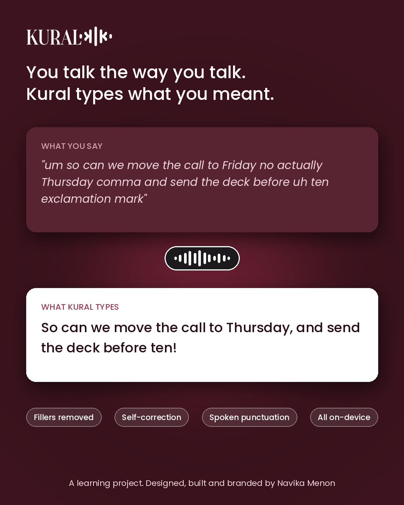
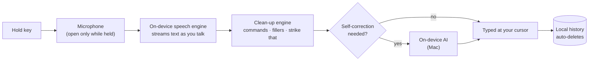

  

  <b>Hold a key. Speak. Your words appear, anywhere you can type.</b> 
  Voice dictation that runs entirely on your own computer: no accounts, no servers, no tracking.

  
  

---

## Why I built Kural

Tools like Wispr Flow and Superwhisper made voice typing fast, but they are paid subscriptions and most send your voice to the cloud. I wanted something **free, fast, and private by design**, where the speech engine, the text clean-up and the history all live on your own machine. Kural is the result: a native Mac app and a Windows app, built from scratch.

Kural is a personal learning project, not a product. I built it to understand how AI tools work end to end, and how the risks they create (privacy, consent, data retention, security) can be designed out and controlled from the start. I also designed its name, logo and full brand identity.

## See it in action

| Onboarding | Home | The listening pill |
|---|---|---|
|  |  |  |

## Features

**Dictation**
- **Hold-to-talk** with any key or key combination you choose
- **Hands-free mode:** double-tap the key to keep listening, tap once to stop
- Works in every app: email, docs, chat, browser, code editors

**Smart clean-up**
- **Voice commands:** "comma", "full stop", "question mark", "exclamation mark", "inverted commas", "new line", "new paragraph", "all caps"
- **"Strike that"** deletes the sentence you just said
- **Filler words removed:** um, uh, er
- **Learns your words:** a personal dictionary picks up names and non-English words (like the Tamil *kutti*) automatically, and learns from any word you fix right after dictating. It ships with a starter pack of common Indian words.
- **Self-correction (Mac):** *"Let's meet Friday, no actually Thursday at 3, I mean 3:30"* becomes *"Let's meet Thursday at 3:30"*, using Apple's on-device AI

**Designed to disappear**
- A small translucent pill with a live waveform that you can drag anywhere. It turns vertical at the screen edges.
- Menu bar / system tray app that starts with your computer
- A **"Copy text"** pop-up appears beside the pill if there's no text box to type into
- Local **History** tab, so a dictation is never lost even if typing fails

## Privacy by design

Privacy isn't a setting in Kural. It's the architecture.

| Data | How Kural handles it |
|---|---|
| **Your voice** | Transcribed on-device, only while the key is held. Never recorded to disk, never uploaded. |
| **Your text** | Typed into your app. Optional local history with automatic deletion (off / 1 / 7 / 30 days). |
| **Date of birth** | Used once for an 18+ age check, then discarded. Only "age confirmed" is kept. |
| **Personal dictionary** | Stored on-device only. Learns from a short window after each dictation; only the corrected word is kept. |
| **Clipboard** | Restored after typing; dictated text is flagged so clipboard-history tools don't keep it. |
| **Everything else** | No accounts, analytics, telemetry or ads. One click deletes all local data. |

Kural was designed around data-protection principles (data minimisation, purpose limitation, storage limitation and the right to erasure) as set out in India's **DPDP Act 2023** and the **GDPR**, with an age gate, versioned Terms and Privacy Policy, and re-consent when the policy changes.

## How it works

## Built with

| | Mac | Windows |
|---|---|---|
| **App** | Swift · AppKit · SwiftUI (native) | Python · customtkinter |
| **Speech** | Apple SpeechAnalyzer (macOS 26), streaming on the Neural Engine | OpenAI Whisper via faster-whisper (int8, CPU) |
| **AI clean-up** | Apple Foundation Models (on-device LLM) | Rule-based engine |
| **Keyboard** | Quartz event taps | Win32 low-level keyboard hooks |
| **Delivery** | Signed .app bundle | Installer built and self-tested by GitHub Actions CI |

**Engineering highlights**
- **Streaming transcription:** audio is transcribed while you speak, so text appears almost as soon as you let go
- **Fail-safe design:** timeouts and watchdogs mean the app never hangs; if typing fails, your words go to the clipboard and history
- **Tested pipeline:** a shared text-processing engine with a regression test suite, plus automated build, package and self-test on every change

## Can I use it?

Kural isn't available to download. It's a learning project, so this page is here to show how it works and the decisions behind it rather than to distribute the app. If you're curious about something specific, or would like a walkthrough, feel free to get in touch.

**Runs on:** Mac (Apple silicon, macOS 26 or newer) and Windows 10 or 11.

## Roadmap
- [x] Personal dictionary that learns your words
- [ ] Tone presets by app (casual for chat, formal for email)
- [ ] Indian languages and code-mixed speech (Tamil, Hindi, Malayalam + English)

## About

Designed, built and branded by **Navika Menon** (B.Tech CSE, AI & ML). I'm interested in privacy engineering and AI risk, and Kural is my exploration of how useful AI tools can be built so that they respect the people who use them.

The source code is private. If you'd like a walkthrough, get in touch.

© 2026 Navika Menon. All rights reserved. Kural is provided as is. See the [Privacy Policy](PRIVACY.md).
