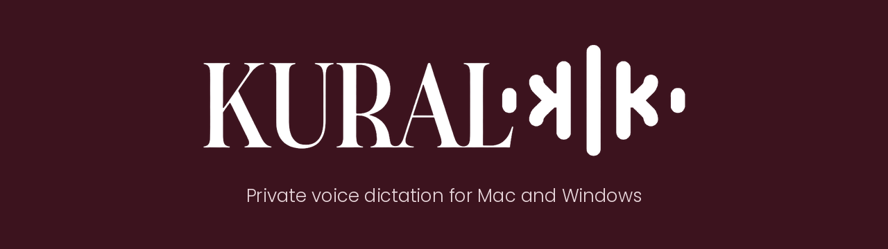
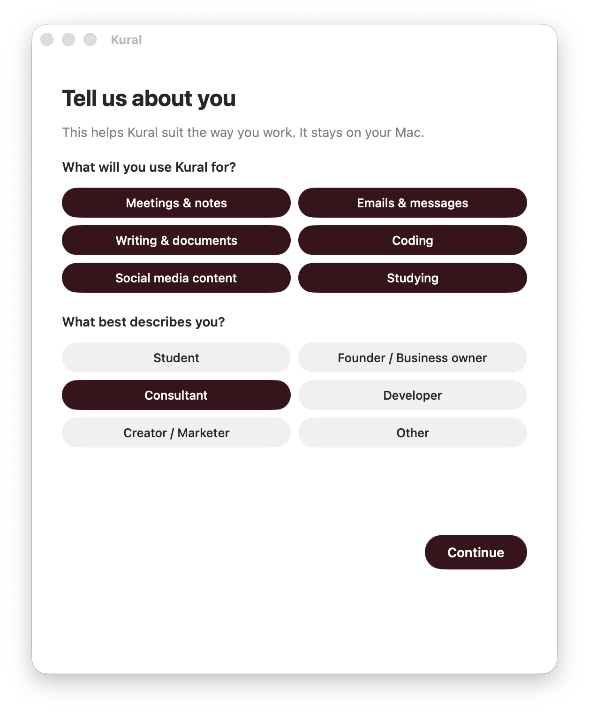
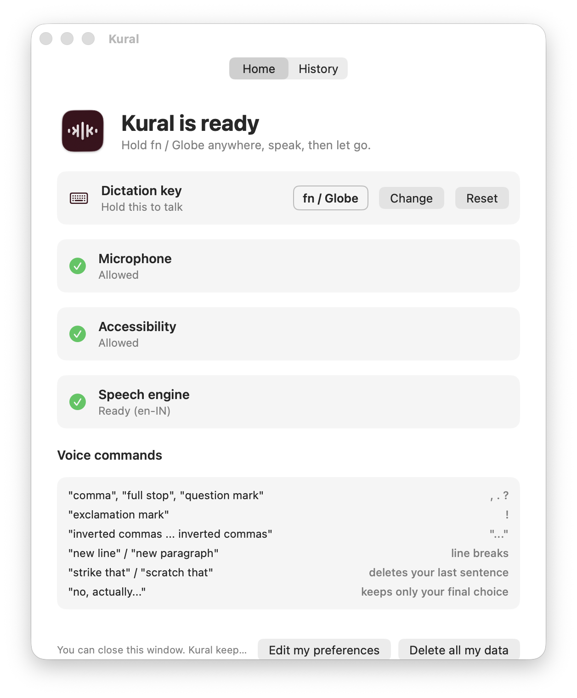
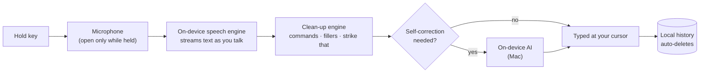

  

  <b>Hold a key. Speak. Your words appear, anywhere you can type.</b> 
  Voice dictation that runs entirely on your own computer: no accounts, no servers, no tracking.

  
  

---

## Why I built Kural

Tools like Wispr Flow and Superwhisper made voice typing fast, but they are paid subscriptions and most send your voice to the cloud. I wanted something **free, fast, and private by design**, where the speech engine, the text clean-up and the history all live on your own machine. Kural is the result: a native Mac app and a Windows app, built from scratch.

## See it in action

| Onboarding | Home | History | The listening pill |
|---|---|---|---|
|  |  |  |  |

## Features

**Dictation**
- **Hold-to-talk** with any key or key combination you choose
- **Hands-free mode:** double-tap the key to keep listening, tap once to stop
- Works in every app: email, docs, chat, browser, code editors

**Smart clean-up**
- **Voice commands:** "comma", "full stop", "question mark", "exclamation mark", "inverted commas", "new line", "new paragraph", "all caps"
- **"Strike that"** deletes the sentence you just said
- **Filler words removed:** um, uh, er
- **Self-correction (Mac):** *"Let's meet Friday, no actually Thursday at 3, I mean 3:30"* becomes *"Let's meet Thursday at 3:30"*, using Apple's on-device AI

**Designed to disappear**
- A small translucent pill with a live waveform that you can drag anywhere. It turns vertical at the screen edges.
- Menu bar / system tray app that starts with your computer
- Local **History** tab, so a dictation is never lost even if typing fails

## Privacy by design

Privacy isn't a setting in Kural. It's the architecture.

| Data | How Kural handles it |
|---|---|
| **Your voice** | Transcribed on-device, only while the key is held. Never recorded to disk, never uploaded. |
| **Your text** | Typed into your app. Optional local history with automatic deletion (off / 1 / 7 / 30 days). |
| **Date of birth** | Used once for an 18+ age check, then discarded. Only "age confirmed" is kept. |
| **Clipboard** | Restored after typing; dictated text is flagged so clipboard-history tools don't keep it. |
| **Everything else** | No accounts, analytics, telemetry or ads. One click deletes all local data. |

Kural was designed around data-protection principles (data minimisation, purpose limitation, storage limitation and the right to erasure) as set out in India's **DPDP Act 2023** and the **GDPR**, with an age gate, versioned Terms and Privacy Policy, and re-consent when the policy changes.

## How it works

## Built with

| | Mac | Windows |
|---|---|---|
| **App** | Swift · AppKit · SwiftUI (native) | Python · customtkinter |
| **Speech** | Apple SpeechAnalyzer (macOS 26), streaming on the Neural Engine | OpenAI Whisper via faster-whisper (int8, CPU) |
| **AI clean-up** | Apple Foundation Models (on-device LLM) | Rule-based engine |
| **Keyboard** | Quartz event taps | Win32 low-level keyboard hooks |
| **Delivery** | Signed .app bundle | Installer built and self-tested by GitHub Actions CI |

**Engineering highlights**
- **Streaming transcription:** audio is transcribed while you speak, so text appears almost as soon as you let go
- **Fail-safe design:** timeouts and watchdogs mean the app never hangs; if typing fails, your words go to the clipboard and history
- **Tested pipeline:** a shared text-processing engine with a regression test suite, plus automated build, package and self-test on every change

## Download

Get the latest version from [**Releases**](../../releases/latest).

| Platform | Requirements |
|---|---|
| **Mac** | Apple silicon (M1 or newer), macOS 26 or newer |
| **Windows** | Windows 10 or 11, 64-bit, 8 GB RAM recommended |

<b>First-time install notes</b>

Kural is an early release and isn't yet notarised by Apple or signed for Microsoft SmartScreen, so your computer will ask you to confirm the first time:

- **Mac:** open Kural, click **Done** on the warning, then go to **System Settings > Privacy & Security** and click **Open Anyway**.
- **Windows:** on "Windows protected your PC", click **More info**, then **Run anyway**.

On first launch, Windows downloads its speech model once (about 150 to 250 MB). After that, Kural works offline.

## Roadmap
- [ ] Custom vocabulary (names, brands, jargon) in the app
- [ ] Tone presets by app (casual for chat, formal for email)
- [ ] Indian languages and code-mixed speech (Tamil, Hindi, Malayalam + English)
- [ ] Apple notarisation and Windows code signing

## About

Designed and built by **Navika Menon** (B.Tech CSE, AI & ML). I'm interested in privacy engineering and AI risk, and Kural is my exploration of how useful AI tools can be built so that they respect the people who use them.

The source code is private. If you're a recruiter, investor or collaborator and would like a walkthrough, get in touch.

© 2026 Navika Menon. All rights reserved. Kural is provided as is. See the [Privacy Policy](PRIVACY.md).
